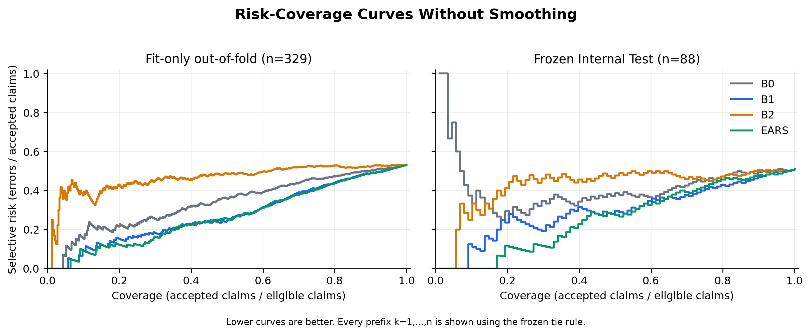

# Evidence-Aware Risk Scoring for Scientific Claim Verification

[](#independent-results)
[](RESEARCH_PROTOCOL.md)
[](LICENSE)

> Research prototype only. This is not a fact-checking service. The repository does not provide medical advice, a scientific-truth service, calibrated error probabilities, or a deployment-ready verifier.

## Research Question

Can a frozen error-risk model that combines NLI behavior with label-free retrieval/evidence signals rank scientific claim-verification errors better than a matched NLI-only risk model?

## Method

The base E1 verifier retrieves SciFact abstracts with BM25, selects three sentences from each of the top five documents using label-free lexical overlap, and applies the pinned `cross-encoder/nli-distilroberta-base` model to 15 sentence-claim pairs. Claim aggregation produces SUPPORT, CONTRADICT, or the model output NO_RELATION.

Full EARS is an L2 logistic-regression error-ranking model using:

- final-decision confidence;
- support-contradiction margin;
- predicted decision category;
- normalized BM25 top-two margin;
- evidence-conflict rate.

The primary B1 comparator uses the same training claims, target, preprocessing, regularization, and solver, but only the NLI-derived features. EARS is a combination of established methods, not a claimed algorithmic breakthrough.

## Dataset

The study uses the official [SciFact](https://github.com/allenai/scifact) release. Only official Train was divided into connected cited-document groups:

| Partition | Claims | Use |
|---|---:|---|
| Fit | 527 | E1 fit-only analysis and final risk-model training |
| Calibration | 141 | Not used in the reported H1 study |
| Frozen Internal Test | 141 | One-time independent evaluation |

Only claims with authentic, single-label SUPPORT or CONTRADICT evidence enter error metrics. The Internal Test had 88 eligible claims; 53 claims without annotated evidence were not relabeled as Neutral or Evidence Insufficient.

Raw SciFact data are not redistributed here. Claims/annotations are CC BY 4.0; S2ORC abstracts are ODC-By 1.0; upstream SciFact code is Apache-2.0. See [THIRD_PARTY_NOTICES.md](THIRD_PARTY_NOTICES.md).

## Independent Results

The frozen E1 verifier achieved **0.488636 accuracy** on 88 eligible Internal Test claims.

| Method | AURC ↓ | R80 ↓ | Errors among 70 accepted |
|---|---:|---:|---:|
| B0 maximum confidence | 0.420457 | 0.471429 | 33 |
| B1 NLI-only | 0.300833 | **0.428571** | **30** |
| B2 evidence-only | 0.431151 | 0.471429 | 33 |
| Full EARS | **0.264987** | 0.457143 | 32 |

- Delta AURC (EARS - B1): **-0.035846**, paired 95% CI **[-0.076087, -0.003447]**.
- Delta R80 (EARS - B1): **+0.028571**, paired 95% CI **[0.000000, 0.063492]**.

**H1 INCONCLUSIVE under the preregistered joint criterion.** EARS improved average risk-coverage ranking but was worse at the fixed 80% coverage point. It is incorrect to claim that EARS was proven generally superior to NLI-only risk scoring.



## Limitations at a Glance

- only 88 eligible independent-test claims and 39 eligible connected groups;
- weak base verifier: 45 errors among 88 eligible claims;
- held-out subset of SciFact Train, not an external dataset;
- NO_RELATION is a model aggregation outcome, not validated evidence insufficiency;
- EARS values are uncalibrated ranking scores, not error probabilities;
- H2 evidence-degradation robustness and H3 probability calibration were **Not Evaluated**;
- no medical, clinical, policy, or other high-stakes deployment validation.

See [LIMITATIONS.md](LIMITATIONS.md) for the full boundary statement.

## Reproduce Locally

Python 3.12 is required. Apple Silicon with 24 GB RAM was sufficient for the recorded run.

```bash
python3.12 -m venv .venv
source .venv/bin/activate
pip install -r requirements-phase4.txt
pip install -e .
```

Download the audited official SciFact archive; the script checks its SHA-256:

```bash
bash scripts/download_scifact.sh data/raw/scifact
```

Generate and audit the split:

```bash
python scripts/audit_scifact.py \
  --data-dir data/raw/scifact \
  --output reports/data_audit.json
python scripts/make_train_splits.py \
  --train-file data/raw/scifact/claims_train.jsonl \
  --output splits/train_split_manifest.json \
  --seed 20261012
```

The research scripts are intentionally staged. Read [RESEARCH_PROTOCOL.md](RESEARCH_PROTOCOL.md) before execution. A full clean reproduction should run Phase 1, Phase 2B, and Phase 3B in order, preserving their manifests and access gates:

```bash
python scripts/run_phase1.py \
  --root . \
  --config configs/phase1_baseline.json \
  --output-dir reports/phase1
python scripts/build_phase1_reports.py --root .

PYTHONPATH=src python scripts/run_phase2b.py \
  --root . \
  --output-dir reports/phase2b \
  --run-id phase2b_fit_crossfit_v1_canonical

PYTHONPATH=src python scripts/run_phase3b_train.py --root .
PYTHONPATH=src python scripts/run_phase3b_inference.py --root .
PYTHONPATH=src python scripts/run_phase3b_evaluate.py \
  --root . \
  --output-dir reports/phase3b
```

These commands are for a clean checkout with no existing formal output directories: the Phase 3B scripts intentionally refuse to overwrite frozen artifacts. The published Internal Test is no longer unseen and must not be reused for new model selection.

Regenerate publication figures from already-frozen aggregate outputs:

```bash
python scripts/build_phase4_figures.py --root . --output-dir reports/phase4/figures
```

Run all tests:

```bash
PYTHONPATH=. pytest -q
```

Detailed environment, seeds, artifacts, and known technical incidents are documented in [REPRODUCIBILITY.md](REPRODUCIBILITY.md).

## Local Research Demo

The Streamlit interface needs the official SciFact corpus and locally reproduced Phase 3B joblib bundles, which are not included in this release candidate.

```bash
streamlit run demo/app.py
```

The demo displays retrieved documents, selected sentences, raw NLI scores, the E1 category, and uncalibrated B1/EARS ranking scores. It does not implement a deployment threshold. See [demo/README.md](demo/README.md).

## Repository Map

```text
configs/          frozen experiment configurations
demo/             local Streamlit research interface
paper/            reviewed manuscript source and PDF
reports/          aggregate results and publication figures only
scripts/          data, experiment, audit, and figure scripts
splits/           frozen group-aware split manifest
src/              reusable pipeline and evaluation code
tests/            unit and integration tests
```

Raw data, claim-level predictions, caches, secrets, and trained model bundles are excluded from the release candidate.

## Research Ownership and AI Assistance

The project owner controlled the research objective, protocol approvals, release decisions, and final claims, and remains responsible for understanding and defending the work. AI-assisted tools supported literature discovery, implementation, statistical checks, documentation, and artifact production. No unaided implementation, publication, peer review, institutional affiliation, research supervisor, or external endorsement is claimed. See [RESEARCH_OWNERSHIP.md](RESEARCH_OWNERSHIP.md).

## Citation and License

Use [CITATION.cff](CITATION.cff) after replacing the owner placeholder before publication. The release candidate contains an Apache-2.0 code-license draft that requires owner approval. Dataset and model licenses remain separate.

