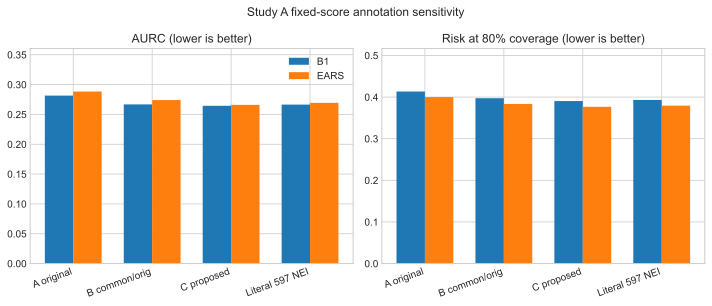

# Trustworthy-AI V3.1: Benchmark Reliability and Annotation Sensitivity

V3.1 is a closed, post-hoc reliability study of the frozen V2 SciFact Dev comparison. It asks how proposed benchmark-annotation corrections and the resulting eligibility changes affect B1 and EARS selective-prediction metrics. It does not train or tune a model, create a new independent test, or establish corrected labels as ground truth.

## Status

- **V3.1 research development:** CLOSED
- **Further model development:** NO-GO
- **Independent annotation ratification:** NOT COMPLETED
- **Scientific results:** FROZEN
- **External validation:** NOT ESTABLISHED
- **Peer-review/publication status:** research artifacts only; not peer-reviewed or accepted

## Main result

All V2 predictions, B1/EARS risk scores, parameters, and rankings were held fixed. Under the proposed-corrected eligible cohort:

| Endpoint | B1 | EARS | EARS − B1 | Paired 95% group-bootstrap CI |
|---|---:|---:|---:|---:|
| AURC ↓ | 0.264484 | 0.265947 | +0.001463 | [−0.021816, +0.026993] |
| R80 ↓ | 0.390411 | 0.376712 | −0.013699 | [−0.039735, +0.006993] |

The corrected cohort contains 182 claims in 159 evidence groups. Neither paired interval excludes zero, so the comparison remains statistically inconclusive. EARS superiority is not established.

Study A+ further showed that two documented annotation proposals can reverse the near-zero ΔAURC point ordering in a specified fixed-cohort scenario. This is a sensitivity result, not statistical significance. Six claims made ineligible by proposed NEI corrections were all errors under the frozen verifier, so cohort composition explains much of the lower absolute risk. Claim 597 remains unresolved.



## Why V3.1 was performed

Frozen V2 concluded `H1 INCONCLUSIVE`: EARS improved Internal-Test AURC but worsened R80, while the later SciFact Dev evaluation did not show a stable advantage. A third-party BioNLP 2026 audit then proposed SciFact annotation corrections. Study A measured their effect without retraining; Study A+ added exact AURC influence mathematics, exhaustive documented-scenario bounds, and a cohort-versus-label decomposition.

The proposed corrections originate from Julien Sylvestre's annotation audit. V3.1 maps and analyzes them but does not claim discovery credit or independent human confirmation.

## Read the record

- [Research summary](RESEARCH_SUMMARY.md)
- [Final completion report](FINAL_COMPLETION_REPORT.md)
- [Scientific limitations](SCIENTIFIC_LIMITATIONS.md)
- [Study A statistical report](STUDY_A_STATISTICAL_REPORT.md)
- [Study A+ mathematical derivation](STUDY_A_PLUS_MATHEMATICAL_DERIVATION.md)
- [Annotation-sensitivity bounds](ANNOTATION_SENSITIVITY_REPORT.md)
- [Cohort-versus-label decomposition](COHORT_VS_LABEL_DECOMPOSITION.md)
- [Claim 597 resolution report](CLAIM_597_RESOLUTION_REPORT.md)
- [Scientific assessment](SCIENTIFIC_ASSESSMENT.md)
- [Unreviewed Study A paper draft](STUDY_A_RESEARCH_PAPER_DRAFT.md)
- [Reproducibility statement](REPRODUCIBILITY.md)
- [AI-assistance disclosure](AI_ASSISTANCE_DISCLOSURE.md)
- [Third-party notices](THIRD_PARTY_NOTICES.md)
- [Feasibility and protocol archive](feasibility/)
- [SHA-256 manifest](MANIFEST.sha256)

## Public-package boundary

This directory publishes aggregate reports, exact sensitivity outputs, SVG figures, synthetic mathematical tests, and a portable analysis script. It excludes raw SciFact/Check-COVID/CORD-19 data, model weights, caches, private prediction artifacts, and two historical Study A files containing owner-machine paths.

The mathematical tests are fully public. Recomputing the real Study A/A+ results requires the hash-identified compact E1 artifact, which is not in the public V2 repository. See [REPRODUCIBILITY.md](REPRODUCIBILITY.md); do not describe this package as complete independent end-to-end reproduction.

## Package map

```text
research/v3.1/
├── data/          non-sensitive mappings and aggregate/exact outputs
├── environment/   recorded clean-environment dependency inventory
├── feasibility/   V3.1 protocol and feasibility audit record
├── figures/       deterministic aggregate SVG figures
└── scripts/       portable Study A+ analysis and mathematical tests
```

All substantive AI assistance remains disclosed. The sole human project owner retains responsibility for public claims, licensing, and release decisions; this does not imply unaided authorship of every technical contribution.
